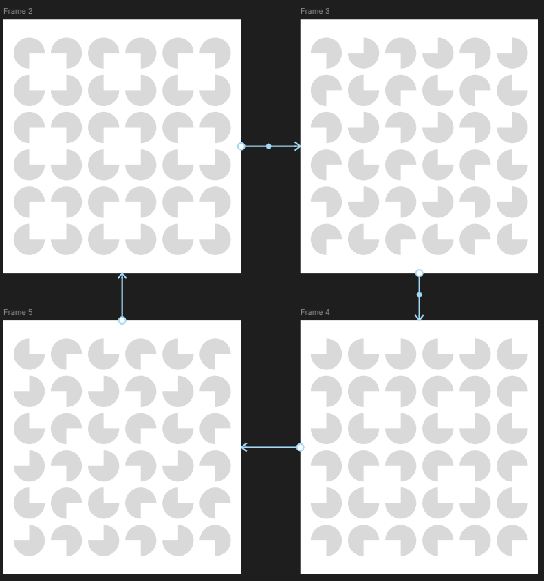

# 02 – Rotating Circle Grid 1

A 6 × 6 grid of circles, each missing one quarter. At the start, the missing quarters of every 2 × 2 block face each other, forming white squares between the circles. The whole grid then rotates in quarter turns, pausing after each turn, and returns to its starting position after four turns.

## Starting point: Figma sketch

The idea started as a sketch in Figma made of four frames, each showing the grid one quarter turn further. The code was vibe-coded from this sketch.

## How it works

- **Three-quarter circles:** `drawCircle()` draws a pie shape with `moveTo()` to the centre, `arc()` around three quarters of the circle, and `closePath()` back to the centre.
- **Starting position:** `startQuadrant()` uses whether the row and column are even or odd (`% 2`) to decide which quarter is missing, so the gaps in each 2 × 2 block point towards the same spot.
- **Rotation:** every circle gets the same extra `rotation` added to its starting angle, so they all turn together.
- **Rotate, then pause:** `rotationAt()` splits time into cycles of a pause (`pauseMs`) followed by a rotation (`rotateMs`). An easing function (`easeInOutCubic`) makes each turn start slowly, speed up and slow down again.
- **Animation loop:** `requestAnimationFrame()` calls `frame()` before every screen refresh.
- **Responsive canvas:** `resize()` makes the canvas 90% of the smallest window side and takes the screen's pixel density (`devicePixelRatio`) into account so the circles stay sharp.

## Settings

All adjustable values are in the `CONFIG` object at the top of the script:

| Setting | What it does |
|---------|--------------|
| `rows`, `cols` | Number of rows and columns |
| `color` | Colour of the circles |
| `gapRatio` | Space between circles, relative to the cell size |
| `paddingRatio` | White margin around the grid, relative to the canvas size |
| `rotateMs` | Duration of one quarter turn, in milliseconds |
| `pauseMs` | Pause after each quarter turn, in milliseconds |

## JavaScript concepts

- Objects (`CONFIG`, one object per circle)
- Arrays and `for...of` loops
- Nested `for` loops to build a grid
- The remainder operator `%` for even/odd patterns
- Angles in radians (`Math.PI / 2` is a quarter turn)
- Canvas 2D paths: `beginPath()`, `moveTo()`, `arc()`, `closePath()`, `fill()`
- `requestAnimationFrame()` and time-based animation
- Easing functions
- Event listeners (`resize`)

## Running

Open `index.html` with Live Server.
